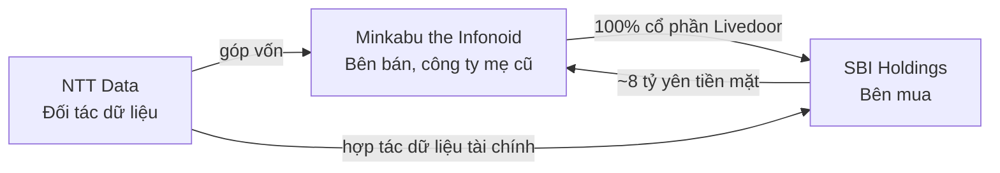
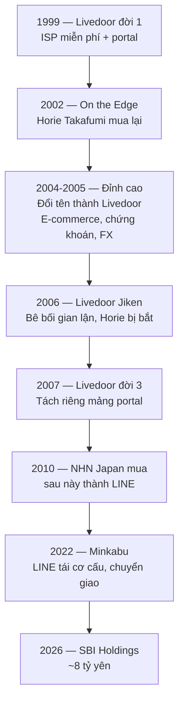
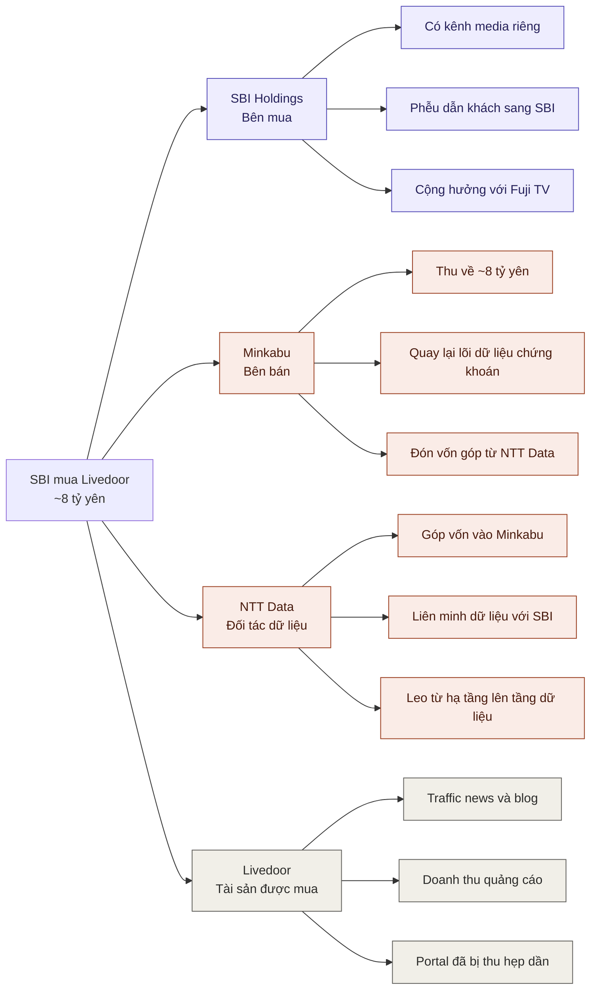
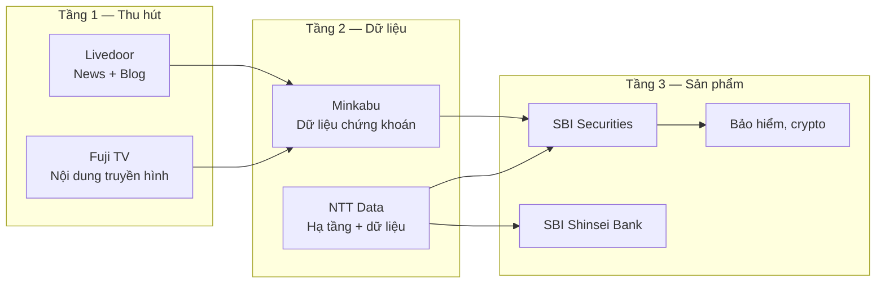

# SBI mua Livedoor 8 tỷ yên: khi một tập đoàn tài chính đi mua phễu traffic

> Ngày 17/9/2026, Nikkei đưa tin SBI Holdings sắp mua **100% cổ phần Livedoor** từ Minkabu the Infonoid với giá khoảng **8 tỷ yên** (~1.4 nghìn tỷ VND). Con số nhỏ đến mức gần như không đáng kể với SBI — nhưng vị trí của Livedoor trong chuỗi giá trị thì không nhỏ. Bài này mổ xẻ cấu trúc thương vụ, động cơ của từng bên, và vì sao một công ty chứng khoán lại đi mua một trang blog.

---

## Mục lục

1. [Thương vụ: ai mua gì của ai](#1-thương-vụ-ai-mua-gì-của-ai)
2. [Livedoor là ai — 5 đời chủ trong 27 năm](#2-livedoor-là-ai--5-đời-chủ-trong-27-năm)
3. [Mô hình kinh doanh hiện tại của Livedoor](#3-mô-hình-kinh-doanh-hiện-tại-của-livedoor)
4. [Sơ đồ chiến lược: động cơ từng bên](#4-sơ-đồ-chiến-lược-động-cơ-từng-bên)
5. [Chuỗi giá trị SBI đang ghép lại](#5-chuỗi-giá-trị-sbi-đang-ghép-lại)
6. [NTT Data — mảnh ghép ít được chú ý nhất](#6-ntt-data--mảnh-ghép-ít-được-chú-ý-nhất)
7. [Rủi ro và những câu hỏi còn mở](#7-rủi-ro-và-những-câu-hỏi-còn-mở)
8. [Kết luận](#8-kết-luận)

---

## 1. Thương vụ: ai mua gì của ai

Cấu trúc giao dịch có ba bên, không phải hai:

Ba động tác diễn ra gần như đồng thời:

| Động tác | Nội dung |
|---|---|
| **Mua bán** | SBI mua 100% cổ phần Livedoor K.K. từ Minkabu, ~8 tỷ yên, Livedoor thành công ty con hoàn toàn |
| **Góp vốn** | NTT Data rót vốn vào Minkabu (công ty mẹ vừa bán Livedoor) |
| **Liên minh** | NTT Data và SBI hợp tác trong mảng **dữ liệu tài chính** (金融データ事業) |

Đây không phải tin bất ngờ. Từ **tháng 5/2026**, SBI đã công bố bắt đầu đàm phán liên minh vốn — kinh doanh (資本業務提携) với Livedoor. Thương vụ tháng 9 là bước leo thang từ "liên minh" lên "thâu tóm toàn bộ".

Thị trường phản ứng ngay: cổ phiếu Minkabu **tăng kịch trần** (ストップ高) trong ngày tin được đưa.

---

## 2. Livedoor là ai — 5 đời chủ trong 27 năm

Với người ngoài Nhật, "Livedoor" có thể là một cái tên xa lạ. Với người trong ngành internet Nhật, đây là một trong những thương hiệu có lịch sử drama nhất.

Vài mốc đáng chú ý:

**2004–2005 — thời hoàng kim.** Dưới tay **Horie Takafumi** (biệt danh Horiemon), Livedoor mở rộng sang e-commerce (shopping, đấu giá), dịch vụ tài chính (chứng khoán, FX, hợp đồng tương lai), mail, search. Horie công khai tuyên bố muốn đưa Livedoor lên ngang tầm Yahoo! Japan, và thực hiện vụ thâu tóm thù địch Nippon Broadcasting System gây rung chuyển giới tài chính Nhật.

**2006 — cú sụp.** Vụ bê bối *Livedoor Jiken* (gian lận kế toán và thao túng cổ phiếu) khiến Horie bị bắt và rời ban điều hành. Tài sản công ty bị bán tháo từng phần.

**2010–2022 — 12 năm trong tay LINE.** NHN Japan (sau đổi tên thành LINE) mua lại mảng portal. Giai đoạn này là chuỗi đóng cửa dịch vụ liên tục: mail (2013), dịch thuật (2015), **search và thời tiết (2020)**. Sau khi ZHD và LINE sáp nhập năm 2019, tập đoàn có tới hai portal song song là Yahoo! Japan và Livedoor — Livedoor đương nhiên là bên bị hy sinh.

**2022 — về với Minkabu.** LINE chuyển giao mảng Livedoor cho Minkabu the Infonoid. Horie quay lại với vai trò Executive Advisor. Và chỉ **4 năm sau**, Minkabu bán tiếp.

Điểm quan trọng để đánh giá thương vụ 2026: **Livedoor đã không còn là portal tổng hợp từ 2020**. Sau khi search và thời tiết đóng cửa, nó chỉ còn là một media portal.

---

## 3. Mô hình kinh doanh hiện tại của Livedoor

Những gì SBI thực sự mua, gọn hơn nhiều so với cái tên gợi ra:

| Dịch vụ | Mô tả |
|---|---|
| **livedoor ニュース** | Trang tổng hợp tin tức (news aggregator), mô hình giống Yahoo! News |
| **livedoor Blog** | Nền tảng blog, một trong những dịch vụ blog lâu đời còn sống ở Nhật |
| **Peachy** | Chuyên trang nội dung lifestyle |
| **livedoor Choice** | Trang review/so sánh dịch vụ, ra mắt 2023 |

Nguồn thu: **quảng cáo** trên news và blog, cộng một phần **phí dịch vụ trả phí**.

Nói cách khác, mô hình kinh doanh của Livedoor 2026 là mô hình **media thuần** — bán inventory quảng cáo dựa trên lưu lượng truy cập. Không có search, không có mail, không có e-commerce, không có dịch vụ tài chính nào còn lại từ thời Horie.

Vậy vì sao một tập đoàn tài chính lại trả 8 tỷ yên cho một tài sản đang suy giảm?

---

## 4. Sơ đồ chiến lược: động cơ từng bên

### SBI được gì

SBI Holdings vận hành SBI Securities (công ty chứng khoán online lớn nhất Nhật), SBI Shinsei Bank, bảo hiểm, crypto, VC. Vấn đề cố hữu của mô hình này: **dịch vụ tài chính có tần suất tiếp xúc rất thấp**. Người dùng mở app chứng khoán vài lần một tuần là nhiều; mở app tin tức thì vài lần một ngày.

Livedoor cung cấp đúng thứ SBI thiếu: **điểm tiếp xúc tần suất cao với người chưa phải khách hàng tài chính**.

Đây cũng không phải nước đi đơn lẻ. Tháng 6/2026, **Fuji Media Holdings** đã hợp tác truyền thông với SBI, chuyển hướng khỏi con đường độc lập sang đồng sản xuất nội dung. Ghép lại, có thể thấy SBI đang xây một tầng media riêng: truyền hình (Fuji) + digital (Livedoor).

### Minkabu được gì

Minkabu nhận Livedoor từ LINE năm 2022 để mở rộng quy mô mảng media, nhưng sự kết hợp không cộng hưởng: Minkabu là nền tảng **dữ liệu chứng khoán chuyên sâu**, Livedoor là **media đại chúng**. Hai tập người dùng gần như không giao nhau.

Bán Livedoor giúp Minkabu:
- Thu về khoảng 8 tỷ yên tiền mặt
- Quay lại tập trung vào lõi dữ liệu tài chính
- Đón vốn góp từ NTT Data

Phản ứng cổ phiếu trần cho thấy nhà đầu tư đồng tình: trong tay Minkabu, Livedoor là gánh nặng hơn là tài sản.

---

## 5. Chuỗi giá trị SBI đang ghép lại

Đây là phần tôi cho là quan trọng nhất khi đọc thương vụ này. SBI không mua một công ty internet — SBI mua **đầu vào lưu lượng** cho một chuỗi giá trị đã có sẵn ba tầng dưới.

Logic phễu: người dùng đọc tin tức trên Livedoor → gặp nội dung tài chính được cá nhân hoá bằng dữ liệu Minkabu/NTT Data → chuyển đổi thành tài khoản chứng khoán hoặc ngân hàng SBI → bán chéo sang bảo hiểm, crypto.

So sánh với đối thủ: đây chính xác là mô hình mà **LY Corporation** (Yahoo! Japan + LINE) đã có sẵn — Yahoo! News dẫn sang Yahoo! Finance dẫn sang PayPay Securities. SBI đang cố dựng một phiên bản tương tự, và Livedoor là mảnh mà LY Corp đã bỏ đi.

Ở góc độ định giá, 8 tỷ yên là **rất nhỏ** so với quy mô SBI. Đây không phải cược lớn — đây là mua quyền thử nghiệm mô hình media–finance với rủi ro tài chính gần như không đáng kể.

---

## 6. NTT Data — mảnh ghép ít được chú ý nhất

Các bản tin tập trung vào SBI và Livedoor, nhưng vai trò của NTT Data đáng chú ý hơn.

NTT Data vận hành **hệ thống lõi cho phần lớn ngân hàng Nhật** — hạ tầng thanh toán, hệ thống nghiệp vụ, kết nối liên ngân hàng. Đây là vị thế rất chắc nhưng cũng rất "thấp" trong chuỗi giá trị: bán hệ thống là mô hình dự án, biên lợi nhuận bị nén, và giá trị gia tăng ngày càng chuyển lên tầng trên.

Việc đồng thời (a) góp vốn vào Minkabu và (b) liên minh dữ liệu tài chính với SBI là bước **leo lên tầng dữ liệu và dịch vụ**:

- Góp vốn vào Minkabu → có chỗ đứng trong nhà cung cấp dữ liệu thị trường
- Liên minh với SBI → có kênh phân phối tới người dùng cuối
- Kết hợp với hạ tầng đang vận hành → có thể bán "dữ liệu + hệ thống" thay vì chỉ "hệ thống"

Nếu nhìn dài hạn, đây có thể là phần có tác động lớn nhất của cả cụm giao dịch, dù nó được đề cập ngắn nhất trong bản tin.

---

## 7. Rủi ro và những câu hỏi còn mở

**Livedoor là tài sản đang suy giảm.** Lịch sử 15 năm qua của Livedoor là chuỗi đóng cửa dịch vụ liên tục. Traffic news aggregator ở Nhật đang bị bóp từ hai phía: Yahoo! News ở trên và các nền tảng social/短編動画 ở dưới. Mua một tài sản đang trên đường cong đi xuống với kỳ vọng "xoay chuyển bằng cộng hưởng" là kịch bản rất thường thất bại.

**Xung đột lợi ích biên tập.** Một tập đoàn tài chính sở hữu trang tin tức tạo ra vấn đề nghiêm túc: nội dung biên tập và động cơ bán sản phẩm đầu tư nằm dưới cùng một P&L. LY Corp đã phải xử lý điều này rất cẩn thận với Yahoo! Finance. Nếu Livedoor News bắt đầu đọc như kênh phân phối của SBI Securities, traffic — thứ duy nhất SBI mua — sẽ tự bốc hơi.

**Tỷ lệ chuyển đổi chưa được chứng minh.** Giả định cốt lõi của thương vụ là "người đọc tin tức đại chúng có thể chuyển đổi thành khách hàng chứng khoán". Với Minkabu, giả định này đã không hoạt động theo hướng ngược lại. Không rõ vì sao SBI làm được điều Minkabu không làm được, ngoài việc SBI có sẵn sản phẩm tài chính ở đầu ra.

**Câu hỏi còn mở:**
- Livedoor hiện còn bao nhiêu MAU và doanh thu quảng cáo? Bản tin không công bố.
- NTT Data góp bao nhiêu vào Minkabu, tỷ lệ sở hữu ra sao?
- Horie Takafumi — đang là Executive Advisor — có tiếp tục vai trò dưới SBI?
- Phạm vi cụ thể của "hợp tác dữ liệu tài chính" giữa SBI và NTT Data là gì?

---

## 8. Kết luận

Thương vụ này nên được đọc như **ba giao dịch lồng nhau**, không phải một vụ M&A đơn lẻ:

1. SBI mua một điểm tiếp xúc tần suất cao với giá rẻ, tiếp nối chiến lược media đã khởi động với Fuji Media
2. Minkabu thoát khỏi một tài sản không cộng hưởng và đổi lấy tiền mặt cộng vốn góp mới
3. NTT Data dùng cơ hội này để leo từ tầng hạ tầng lên tầng dữ liệu tài chính

Con số 8 tỷ yên nhỏ, nhưng vị trí của Livedoor — nằm ở đầu phễu, nơi người dùng chưa phải khách hàng tài chính — là chỗ mà mọi tập đoàn tài chính đều thiếu và không dễ tự xây.

Điểm cần theo dõi tiếp: SBI xử lý ranh giới giữa nội dung biên tập và bán sản phẩm như thế nào. Đó sẽ là biến số quyết định thương vụ này là bước đi thông minh hay là một tài sản suy giảm được mua với lý do nghe hợp lý.

---

## Nguồn

- [SBI、ライブドア買収へ　NTTデータ・ミンカブ含め金融データで協業](https://www.nikkei.com/article/DGXZQOUB170VA0X10C26A9000000/) — Nikkei, 17/9/2026 (bài gốc, giới hạn cho thành viên)
- [ライブドア — Wikipedia (tiếng Nhật)](https://ja.wikipedia.org/wiki/%E3%83%A9%E3%82%A4%E3%83%96%E3%83%89%E3%82%A2) — lịch sử các đời chủ và danh mục dịch vụ
- Tin liên quan trên Nikkei: *SBI、ライブドアと資本業務提携へ* (19/5/2026), *フジHD、SBIとメディア事業提携* (25/6/2026)

**Lưu ý:** bài gốc trên Nikkei bị giới hạn cho thành viên trả phí (còn 417 ký tự không đọc được). Phần phân tích chuỗi giá trị và rủi ro trong bài này là suy luận của tôi dựa trên thông tin công khai, không phải nội dung từ bài báo.
